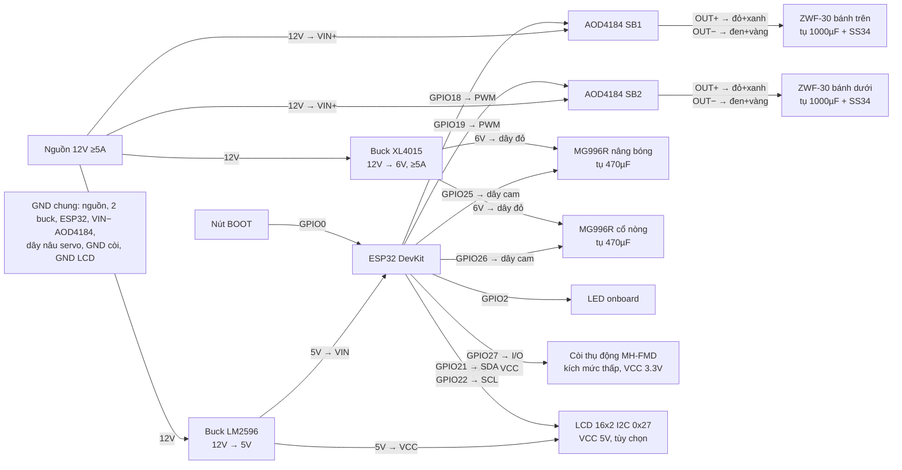
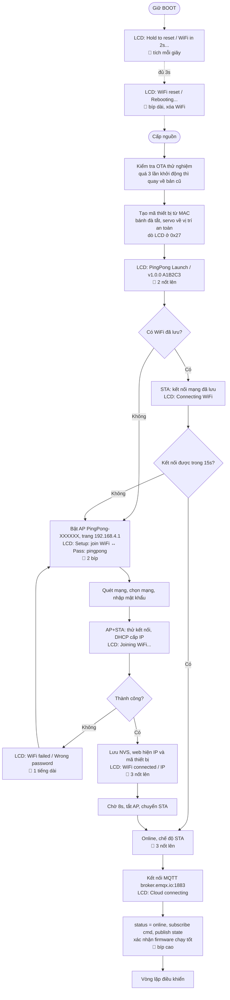
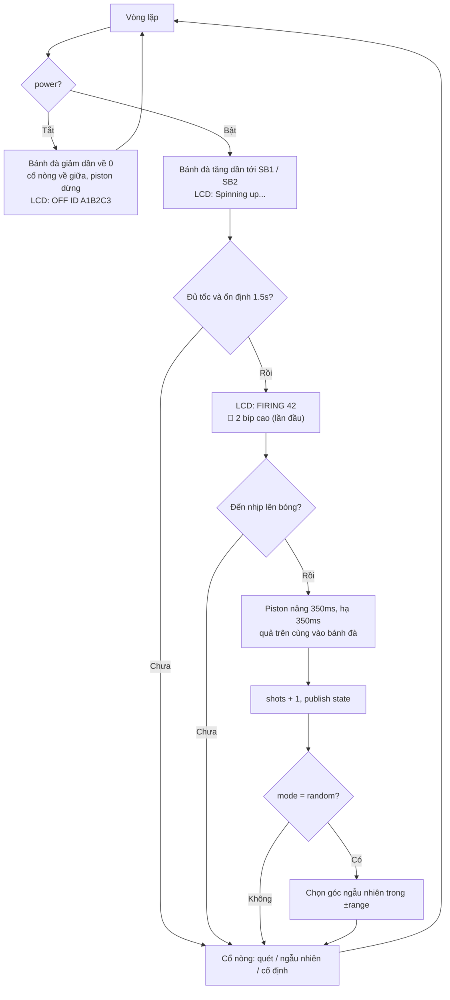
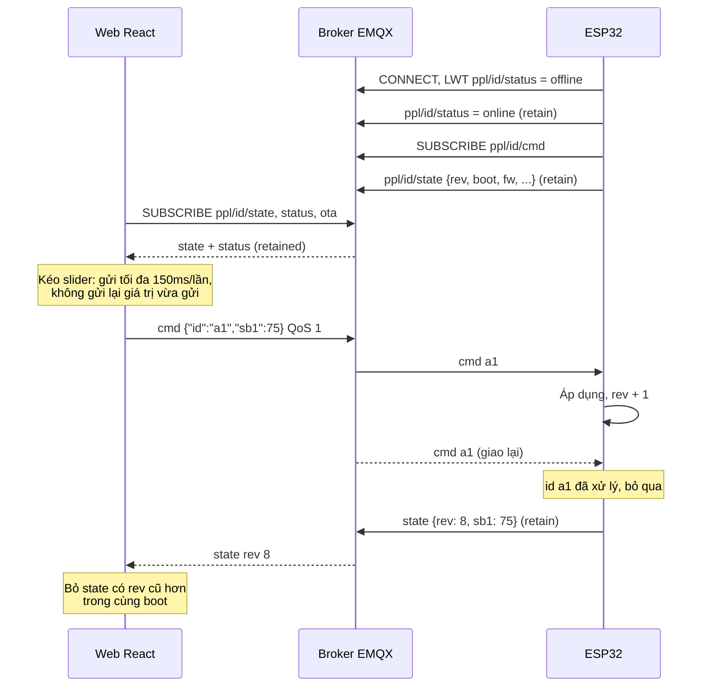
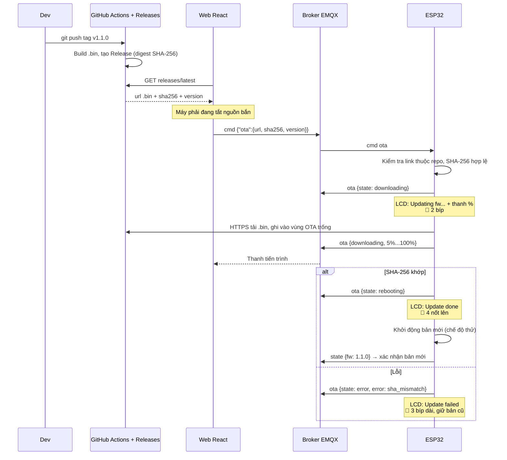

# Sơ đồ máy bắn bóng bàn

## 1. Đấu nối chân

## 2. Khởi động và WiFi

Dòng bắt đầu bằng "LCD:" là nội dung màn hình (tiếng Anh), 🔔 là tiếng còi.

## 3. Vòng lặp bắn

## 4. Đồng bộ MQTT hai chiều

## 5. Cập nhật firmware qua OTA

